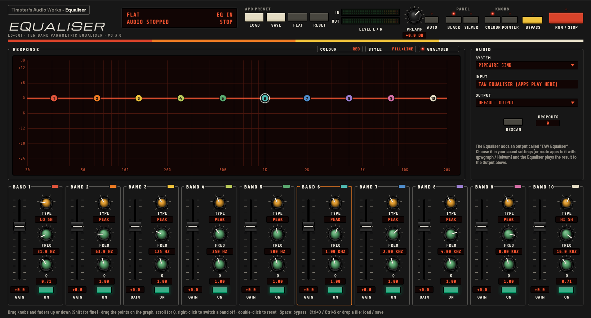
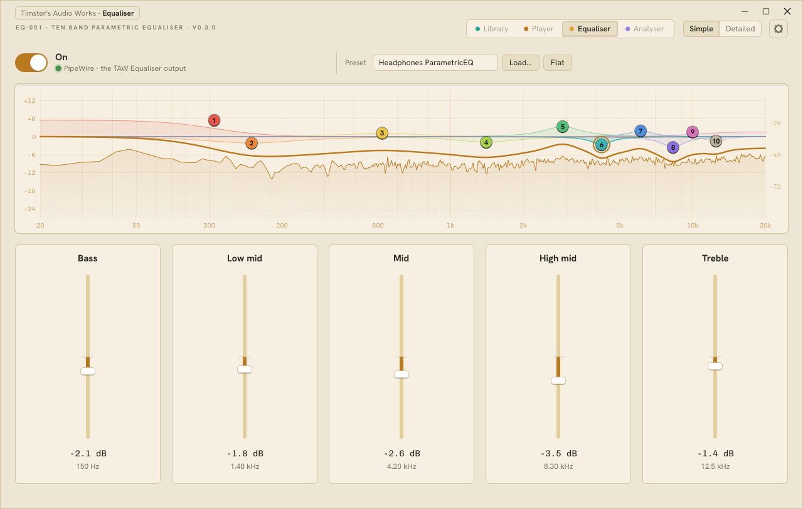
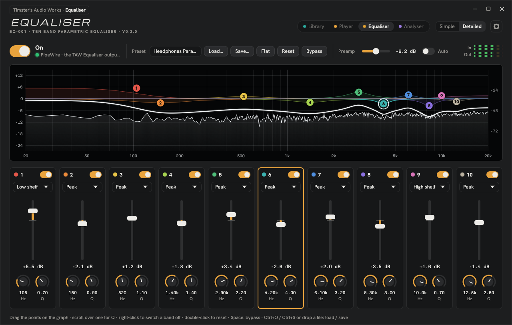
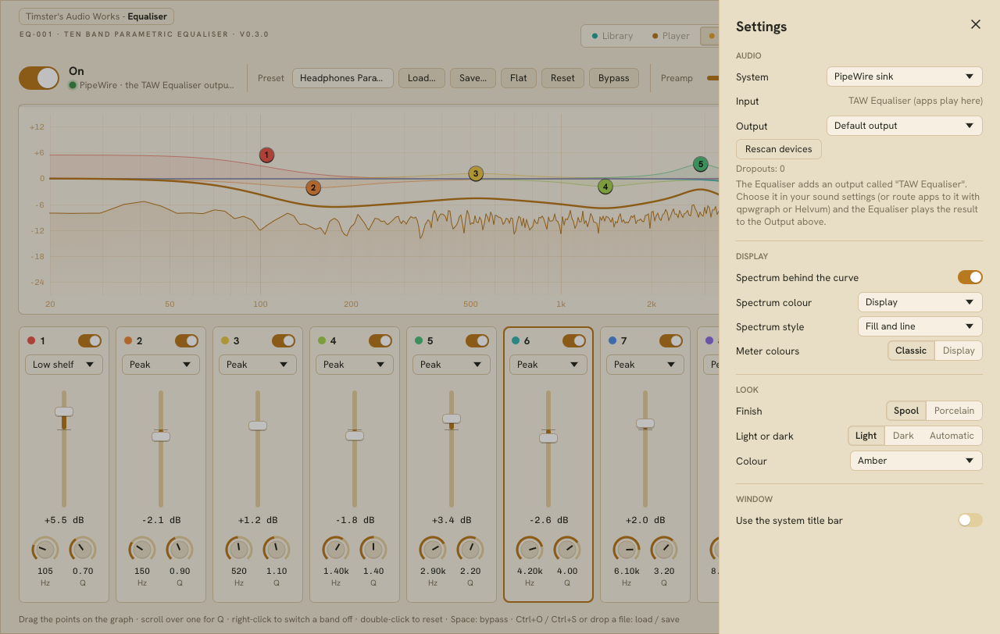

# TAW Equaliser

**Timster's Audio Works – Equaliser (EQ-001) v0.3.2**: a native ten-band parametric equaliser for Windows and Linux. One of the family's hi-fi separates, with the Library, Player and Analyser, in their shared TAW look (Spool or Porcelain, light or dark). It was called EQ Box until 0.3.0.



| Simple | Porcelain, Dark | Settings |
|---|---|---|
|  |  |  |

It's a real desktop program written in Rust (egui for the panel). It isn't an HTML page in a browser.

## Download

Get the latest version from the [Releases page](https://github.com/TimsterAudio/TAW-Equaliser/releases/latest):

- **Linux:** `taw-equaliser-…-linux-x86_64.tar.gz`. Extract it and run `./taw-equaliser`. It needs PipeWire 0.3.53 or newer (Ubuntu 24.04, Fedora 40, Arch or later). On older systems, build it yourself (see [Building](#building)).
- **Windows:** `taw-equaliser-…-windows-x86_64.zip` (WASAPI), or `…-windows-x86_64-asio.zip` with ASIO support as well. Extract it and run `taw-equaliser.exe`.

## What it does

- **10 bands.** Each band is a **peak** (bell), **low shelf** or **high shelf**, with its own on switch. Presets with **high-pass**, **low-pass** or **notch** filters still load and play, and those bands show their type.
- **A clip light on every band:** **HOT** (yellow) when the band's boost leaves too little headroom for loud music, and **CLIP** (red) when the sound really clips and that band is the likely cause.
- **Simple or Detailed.** Simple has five tone sliders (Bass, Low mid, Mid, High mid, Treble) and the preset. Detailed has all ten band cards, the preamp and the meters.
- **Gain from +12 dB to −24 dB**, frequency from 20 Hz to 20 kHz, and **Q from 0.1 to 20**, plus a **preamp** (+12 / −24 dB) with **Auto** (on by default, and always on in Simple: it turns the preamp down just enough for your boosts to stay out of clipping, allowing for the treble's extra headroom) and **Bypass** for A/B checks.
- **Loads APO-format EQ presets**, such as AutoEQ's `ParametricEQ.txt` files. It reads `Preamp:` and `Filter:` lines with the `PK`, `LS`/`LSC`, `HS`/`HSC`, `HP`/`HPQ`, `LP`/`LPQ` and `NO` types, `Fc`, `Gain`, `Q` or `BW Oct`, and `ON`/`OFF`. It **saves** presets in the same format.
- **Response graph:** each band's curve in its own colour, the overall response over them in the display's ink, and a live **spectrum analyser** of the output behind both, in the display's ink or a choice of colour schemes. Drag a band's point to set its frequency and gain, and scroll over it to change Q.
- **Audio systems:**
  - **Windows:** a **system-wide engine** (test build) that runs inside Windows' own audio engine and equalises every app with no virtual cable, plus **WASAPI** and **ASIO** (an optional build feature).
  - **Linux:** a **native PipeWire sink**. The Equaliser shows up as an output called "TAW Equaliser", so any app can play into it. It also has PipeWire and ALSA device modes.
- **The spectrum analyser on its own** is now a separate download: the [TAW Analyser](https://github.com/TimsterAudio/TAW-Analyser) (formerly SP-10).
- **Looks:** the TAW finishes, Spool (with its seven colour themes) or Porcelain, each in Light, Dark or Automatic, chosen in **Settings** (the gear). The Equaliser draws its own title strip and window buttons; Settings can bring back the system title bar.
- **Remembers everything:** bands, preset name, devices, look, Simple or Detailed, and whether audio was on.

## Using it

### Linux (PipeWire)

1. Start the Equaliser and turn on the **On** switch. **System** (in Settings, the gear) starts on **PipeWire sink**.
2. In your desktop's sound settings, choose **TAW Equaliser** as the output. You can also route a single app to it with `pavucontrol`, `qpwgraph` or Helvum.
3. The Equaliser sends the equalised audio to **Output** (in Settings): the default device, or one you pick.

The Equaliser never routes its own output back into itself, even when it is the default output, because the sink and its output share a PipeWire link group. To make it the default from a terminal, find the Equaliser's id in `wpctl status`, then run `wpctl set-default <id>`.

If you'd rather equalise a capture device, choose **PipeWire devices** or **ALSA** in Settings and pick an **Input** and an **Output**.

### Windows (system-wide, test build)

The Equaliser's engine can run inside Windows' own audio engine, so every app on an output is equalised with no extra software. The Windows download has a `system-wide-engine` folder:

1. In the Equaliser's Settings (the gear), set **System** to **Windows (system-wide)** and press **Install engine** (or double-click `Install system-wide engine.cmd`). Allow Windows' permission prompt, then pick your output.
2. Turn on the **On** switch. Your settings go straight to the engine and stay set after the Equaliser closes.
3. **Remove** (or `Remove system-wide engine.cmd`) puts every device back exactly as it was.

If the output already has its own effect from its driver, the Equaliser keeps it and runs it after the EQ.

Apps using exclusive mode or ASIO bypass it, as they do with other EQ software. See `system-wide-engine/README.txt` and [docs/WINDOWS_APO_PLAN.md](docs/WINDOWS_APO_PLAN.md).

### Windows (WASAPI)

Without the system-wide engine, route your audio through a virtual cable:

1. Install a virtual cable, such as [VB-CABLE](https://vb-audio.com/Cable/), and set **CABLE Input** as Windows' default output.
2. In the Equaliser's Settings, set **System** to **WASAPI**, **Input** to **CABLE Output**, and **Output** to your real speakers or headphones.
3. Turn on the **On** switch.

The two devices must run at the same sample rate, which you set under *Sound settings › device › Advanced*. **Buffer** sets the cushion between the input and the output. If you hear crackles, raise it. If you need less delay, lower it.

### Windows (ASIO)

In an ASIO build, choose **ASIO** under **System** in Settings, then pick your interface as both **Input** and **Output**. Send the signal you want equalised into the interface's inputs, for example through a loopback or virtual channel in its mixer software. The Equaliser plays the result to the interface's outputs.

### Controls

| | |
|---|---|
| Knobs and faders | Drag up or down (or left/right). Hold **Shift** for fine control. Scroll to step. Double-click to reset. With a control focused, the arrow keys adjust it (**Shift** for fine). |
| Graph points | Drag to set frequency and gain (**Shift** for fine). Scroll for Q. Double-click for 0 dB. Right-click to switch the band on or off. |
| Filter type | Each band card's menu: **Peak**, **Low shelf** or **High shelf**. A band loaded from a preset as high-pass, low-pass or notch shows that type; those have no gain, so the card says "No gain, fixed slope" instead of a fader. |
| Preamp | **Auto** (on by default) turns the preamp down for your boosts, so music stays out of clipping. A boost in the bass or mids is cut in full; the treble has more headroom, because music carries far less up there, so a treble lift costs little or nothing (none up to 2 kHz, rising 3 dB an octave to 9 dB at 16 kHz). It follows the bands, never the music, and settles when you let go of the mouse. When the bands only cut, it lifts the highest point to 0 dB. Moving the preamp slider takes over from it. Simple always uses Auto; turn it off in Detailed. |
| Keys | **Space**: bypass · **Ctrl+O**: load preset · **Ctrl+S**: save preset |
| Presets | **Load…** / **Save…** buttons, drop a preset file on the window, or pass one on the command line: `taw-equaliser "HD 600 ParametricEQ.txt"`. |
| Clip lights | Above each band's gain (beside each tone slider in Simple). **HOT** (yellow): the band's frequency, gain and Q, with the preamp, take the sound past the headroom (the same allowance Auto uses), so loud music can clip. **CLIP** (red, held 2 s): the output went over full scale and this band, boosting most where the music was loudest, is the likely cause. Hover for what to do. |
| Flat / Reset | **Flat** sets every gain and the preamp to 0 dB. **Reset** also restores the default band layout. |

When a preset has more than ten filters, the Equaliser loads the first ten. It skips filter types it doesn't have (such as band-pass or all-pass), and limits values that are outside the panel's ranges. The footer lists anything it changed.

## Building

You need [Rust](https://rustup.rs) (stable).

**Linux:** install the PipeWire, ALSA and clang headers first (PipeWire 0.3.53 or newer):

```sh
# Debian / Ubuntu 24.04+
sudo apt install libpipewire-0.3-dev libspa-0.2-dev libasound2-dev libclang-dev pkg-config
# Fedora
sudo dnf install pipewire-devel alsa-lib-devel clang-devel
# Arch
sudo pacman -S pipewire alsa-lib clang

cargo build --release
./target/release/taw-equaliser
```

`packaging/linux/taw-equaliser.desktop` is a launcher entry you can copy to `~/.local/share/applications/`.

**Windows (WASAPI):**

```sh
cargo build --release
target\release\taw-equaliser.exe
```

**Windows with ASIO:** you also need [LLVM](https://github.com/llvm/llvm-project/releases), with `LIBCLANG_PATH` pointing at its `bin` folder. The build downloads Steinberg's ASIO SDK. To use a copy you already have, set `CPAL_ASIO_DIR` to it.

```sh
cargo build --release --features asio
```

Before you hand out ASIO builds, check that the ASIO SDK licence you're using allows it. Steinberg licenses the SDK under its own agreement or under GPLv3.

GitHub Actions builds Linux, Windows and Windows + ASIO on every push. The builds are attached to each run as artifacts.

**Releases are automatic.** When `main` has a version in `Cargo.toml` that hasn't been released yet, the Release workflow builds the three packages and publishes them as release `vX.Y.Z`, with that version's section of `CHANGELOG.md` as the notes. If a release for that version was already made by hand on GitHub without any files, it keeps that release and attaches the packages to it.

## Project layout

See [docs/ARCHITECTURE.md](docs/ARCHITECTURE.md) for how the parts fit together, and [docs/DESIGN.md](docs/DESIGN.md) for the panel rules.

## Credits

The fonts in `assets/fonts` are under the SIL Open Font License: Barlow Semi Condensed, Michroma, Share Tech Mono and Space Grotesk. Their licences are in the same folder.
